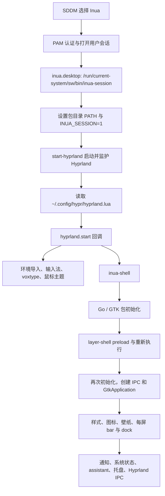

# HX90：Inua 登录流程与黑屏耗时排查

排查日期：2026-10-17。目标是本机 HX90；源码在 `~/development/inua`。
本文依据当前仓库、实际安装的 generation 400、进程、启动日志及不创建窗口的启动测量。

## 结论

已确认一个可复现的启动性能问题：Inua 使用的 puregotk 在 Go 包初始化期间重复寻找动态库。在当前 NixOS 打包方式下，寻找过程回退到外部 `pkg-config`，仅执行系统版 `inua-shell --help` 就调用 **671 次 pkg-config**，耗时约 **2.95 秒**。它还没有进入桌面初始化，更没有创建窗口。

正常启动时 `EnsurePreloaded()` 会为 gtk4-layer-shell 重新执行二进制，Go 包初始化因而再跑一遍。这会放大上述开销。这个机制能解释数秒的确定性延迟，也很可能在刚登录、磁盘缓存未热时更明显；**现有证据不能断言它解释了全部长时间黑屏，也不能把 35 秒全部归到它头上**。

SDDM 到 Hyprland 本身约一秒。本次登录后约 35 秒才出现 assistant 进程，结合源码顺序，说明应重点测量 Inua 启动到 `startAssistant()` 之间的路径。由于登录壳日志没有保存下来，准确的第一帧时间和其中每个阶段的耗时目前不能复原。

## 1. 系统如何安装和加载 Inua

### 声明与构建

`hosts/hx90/configuration.nix` 导入仓库根目录的 `inux.nix`。注意文件名是 **inux.nix**。

`inux.nix` 用 `buildGoModule` 打包开发目录源码：

- 从 `INUA_DEV_DIR` 环境变量读取目录，需要以 `--impure` 求值。
- `cleanSourceWith` 排除 `.git` 和 `bin`，其他内容包括未提交源码会进入源快照。
- 构建 shell、CLI、apps、files、viewer、games、assistant、keyring、pinentry。
- 安装 `.desktop` 会话和应用入口。
- 用 `makeWrapper` 为程序设置 GTK 依赖的 `LD_LIBRARY_PATH` 与 `PKG_CONFIG_PATH`。
- 放入 `environment.systemPackages` 和 `services.displayManager.sessionPackages`。

所以开机登录运行的是**上次系统构建时的源码快照**，不会在每次登录执行 Go 编译，也不会自动读取开发目录里的新二进制。

本次安装包路径为：

```text
/nix/store/0cm8w0l6jkszsiw4qgp52f0bf5alzyx2-inua-dev
```

### 从登录到桌面



实际 SDDM 会话文件位于生成的 `desktops/share/wayland-sessions/inua.desktop`；Exec 指向系统路径的 `inua-session`。

会话脚本把已构建 Inua 包和锁定的 Hyprland 放在 PATH 前面，导出 `INUA_SESSION=1`，最后 `exec start-hyprland`。没有 `start-hyprland` 时回退到 `Hyprland`。

脚本会在旧式 `~/.config/hypr/hyprland.conf` 存在时调用 `inua config hyprland` 检查配置。本机这个文件不存在，实际使用 `hyprland.lua`，因此当前登录不经过这项检查。

### Hyprland 配置接线

Home Manager 部署 `modules/home-manager/hypr/` 到 `~/.config/hypr/`，目标大多是 Nix store 符号链接。

- `bootstrap.lua` 设置 Lua 搜索路径。
- `hyprland.lua` 加载基础配置、显示器、输入、外观、快捷键、自启动，最后 `pcall(require, "inua")`。
- `base/helpers.lua` 的 `o.exec_on_start()` 注册 `hyprland.start` 回调，调用 `hl.exec_cmd()`。
- `autostart.lua` 仅当 `INUA_SESSION=1` 时启动 `inua-shell`。
- `~/.config/hypr/inua.lua` 由 Inua 根据其设置生成，提供规则与快捷键。

这些自启动命令是启动外部进程，配置里的排列顺序不等于“等待前一个进程完成后再启动下一个”。目前没有发现这里人为添加的几十秒 sleep。

Inua 是 Hyprland 上的 GTK4 桌面壳。壁纸、bar、dock 也由它创建，因此 Hyprland 已经运行而壳尚未出画面时，用户仍然会看到黑屏。Labwc / Anchor Shell 是另一个会话。

## 2. 登录版和当前开发版不是同一个运行入口

排查时当前壳进程运行的是：

```text
/home/tetsuya/development/inua/bin/inua-shell -ui-dir /home/tetsuya/development/inua/ui
```

它在登录之后被开发流程替换过；09:37:34 启动的 assistant 则仍来自系统 Inua 包。交互终端的 `command -v inua-shell` 返回 `~/.local/bin/inua-shell`，不能据此认定 SDDM 登录也使用这个文件，因为会话脚本会改 PATH。

修改开发源码或执行本地 reload，并不意味着下次登录会运行相同版本。排查性能时应记录实际 `/proc/PID/exe`、参数和系统包路径。

## 3. 本次启动时间线

| 时间（JST） | 证据 | 含义 |
| --- | --- | --- |
| 09:36:43 | display-manager 启动 | 登录界面启动 |
| 09:36:57 | SDDM 收到 Login，选择 inua.desktop | 用户开始登录 |
| 09:36:58.154 | Starting Wayland user session | PAM 已完成，会话开始 |
| 09:36:59 | Hyprland 进程启动；Fcitx5 开始运行 | 合成器和自启动很快已开始 |
| 09:37:00.206 | Started Portal service | Portal 约 322 ms 完成启动 |
| 09:37:02.004 | Fcitx5 加载 rime | 输入法继续初始化 |
| 09:37:34 | 系统包 inua-assistant --background 进程启动 | Inua 已执行到启动 assistant 附近 |

`startAssistant()` 在 `internal/ui/shell.go:start()` 中位于 `syncBars()` 之后。35 秒是 Hyprland 进程启动到 assistant 进程启动的间隔，**不是已测得的黑屏时长**：其间还包括 GTK 初始化、界面创建及启动通知/系统服务等步骤，`Present()` 返回也不代表第一帧已经显示。

系统整体启动约 30.65 秒，其中 userspace 13.05 秒。这是到系统 graphical.target 的指标，不能代替登录后的桌面首帧耗时。

## 4. 已复现的性能问题

puregotk 的库查找实现见开发源码的：

```text
vendor/codeberg.org/puregotk/puregotk/internal/core/core.go
```

`GetPaths()` 先看 `PUREGOTK_*_PATH`，然后看通用目录和传统发行版目录，最后执行 `pkg-config --libs-only-L`。NixOS 的库位于 `/nix/store`，当前 wrapper 没有设置这些直接路径变量，于是回退到 pkg-config。生成的绑定在多个文件初始化时重复查询，缺少按库复用的查找结果。

只执行系统包的 `--help`，strace 记录：

| pkg-config 包 | 调用次数 |
| --- | ---: |
| gtk4 | 372 |
| gio-2.0 | 152 |
| glib-2.0 | 78 |
| pango | 24 |
| gobject-2.0 | 19 |
| graphene-gobject-1.0 | 17 |
| gdk-pixbuf-2.0 | 6 |
| gmodule-2.0 | 2 |
| cairo-gobject | 1 |
| 合计 | 671 |

正常无 strace 的帮助命令耗时约 2.95 秒。`GODEBUG=inittrace=1` 的另一次测量中，GTK 包约 1346 ms、GIO 615 ms、GLib 300 ms，总包初始化约 3.02 秒。

对照实验仅给 GTK / GDK / GSK 设置 `PUREGOTK_*_PATH`，都指向当前包依赖的 `libgtk-4.so.1`，帮助命令缩短到 **1.228 秒**。这证明直接指定库路径有实际改善；它是热缓存、不同次运行的测量，不能承诺完整登录同比例提速。

`internal/layershell/layershell.go:EnsurePreloaded()` 会通过 `syscall.Exec()` 设置 preload 后重新执行自身。这发生在 Go 包初始化之后，因此正常登录有两轮初始化。帮助命令在 flag 解析时退出，只测了一轮。

## 5. 尚不能认定为原因的项目

- 当前系统和用户没有 failed units；磁盘使用 43%，内存充足，没有证据指向磁盘已满或内存不足。
- 本次 portal 启动约 322 ms，没有观察到常见的 25 秒 portal 启动超时；不能凭黑屏就认定 portal 是原因。
- `gkr-pam: unable to locate daemon control file` 后紧接着 keyring 成功启动并解锁，不支持认定它卡住登录。
- assistant 在 bar 创建调用之后异步启动；不能仅因 assistant 出现较晚就认定 AI 模型加载阻塞桌面。
- 没有通过清空系统缓存或重登制造冷启动，也没有重启、结束桌面壳。

## 6. 建议修复和进一步定位顺序

1. **先修 Nix 打包的库发现路径。** 在 `inux.nix` 的 wrapper 中为 puregotk 设置准确的库路径，避免反复运行 pkg-config。GTK/GDK/GSK 的同库路径已做只读对照验证；其他库需要逐项处理，尤其 GLib 配置包含多个 soname，不能随便只指向一个库导致缺符号。
2. **给启动过程保留日志和阶段时间。** 在唯一的登录自启动命令中将 stdout/stderr 追加到用户状态目录；记录进程创建、main、preload 前后、GTK activate、loadStyles、loadWallpaper、syncBars、startNotify、startSystem、applyHyprland 和首帧。仅有 IPC 日志也不能证明界面可交互，因为 IPC 监听在 GTK 启动之前创建。
3. **再测一次真实冷登录。** 对齐 SDDM、Hyprland、壳阶段时间和首帧，确认剩余延迟落在库初始化、GTK activate、图标/壁纸/字体加载还是其他同步步骤。
4. **考虑上游缓存 `GetPaths()` 结果。** 这是跨发行版的源码优化；Nix wrapper 可以先解决本机问题。preload 机制本身有正确性目的，不能直接删去。

初次排查仅写文档，未修改或应用配置；后续修复见第 8 节。改动前已有的 `modules/dev.nix` 保留原状，开发仓库的已有改动也未修改。

## 7. 复查命令与证据位置

```bash
journalctl -b -u display-manager --no-pager
journalctl -b --since '2026-10-17 09:36:58' --until '2026-10-17 09:37:40' --no-pager
systemd-analyze
systemd-analyze --user blame
ps -eo pid,ppid,lstart,args | rg 'inua|Hyprland|sddm'
readlink /proc/<壳PID>/exe
```

本次临时测量文件（`/tmp` 可能随重启清理）：

- `/tmp/inua-startup-exec.log`：帮助命令的 execve 追踪。
- `/tmp/inua-startup-process-summary.log`：进程系统调用统计。
- `/tmp/inua-startup-init.log`：Go 包初始化时间。
- `/tmp/inua-startup-direct-path-result.json`：三项库路径对照的变量与耗时。

SDDM 的 `~/.local/share/sddm/wayland-session.log` 未包含此次壳启动阶段日志；journal 的 `_COMM=inua-shell` 查询也没有记录。不要把 `/tmp` 中其他日期或热重载日志误当成本次登录日志。

## 8. 本次修复与下次重启的日志

本机打包新增一个只包含所需 soname 的库目录，通过 `PUREGOTK_LIB_FOLDER` 提供给 puregotk。它保留 GLib 同时加载 glib/gobject 的语义，避免逐项单文件路径遗漏符号。用原系统二进制进行完整库目录对照，`--help` 耗时约 **0.075 秒**，此前为 2.95 秒；这是热缓存测量，不等于完整登录耗时。

系统构建在源码快照中注入阶段日志，开发 checkout 不受修改。构建时忽略 checkout 的生成物 `vendor/`，由 buildGoModule 按 go.mod/go.sum 和固定 hash 生成依赖，避免旧 vendor 与当前 go.mod 不一致。

下次在 SDDM 选择 Inua 后，日志自动写入：

```text
~/nixos-config/logs/inua-login-YYYYMMDD-HHMMSS-XXXXXX.log
```

每次登录生成新文件，不覆盖以前的日志。文件权限为仅用户可读写，仓库根目录的 `/logs/` 已加入 `.gitignore`。

同一文件包含：会话开始的绝对时间与 uptime、壳启动时间、Go inittrace（包括 preload 前后两轮）、main、GTK activate、样式/壁纸/bar、通知/系统服务、Hyprland 配置及主循环恢复处理的时间。`main-loop idle` 是初始化返回后主循环的进度点，**不是显示器呈现第一帧的证明**。

查看最新日志：

```bash
ls -lt ~/nixos-config/logs/
rg 'session-start|shell-launch|startup:|started:|bar:' ~/nixos-config/logs/inua-login-*.log
```

仅系统包的构建快照有上述阶段计时；手动启动开发目录的二进制仍使用开发源码原有日志。`inua-shell-startup` 显式启动同一 generation 的 Inua 包，避免用户 PATH 覆盖登录入口。

验证结果：`nix flake check --no-build --impure` 通过，HX90 系统构建通过；新系统包的帮助命令 execve 追踪显示 **0 次 pkg-config 调用**。日志启动器通过 `--help` 验证时间戳、Go inittrace 和输出重定向，未创建第二个桌面壳。配置通过 `nixos-rebuild boot` 安装供下次开机使用，当前桌面未切换。完整冷登录耗时仍需下次重启日志确认。
